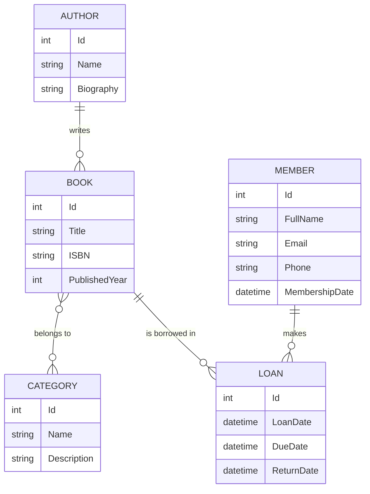

# Library Management System

A console-based library management system built with .NET 10, Entity Framework Core, and SQL Server. It demonstrates a Code-First relational design: entity configuration with the Fluent API, migrations, seed data, and LINQ queries with grouping and aggregation.

## Tech Stack

| Layer | Technology |
|-------|------------|
| Runtime | .NET 10 |
| ORM | Entity Framework Core 10 (Code-First) |
| Database | SQL Server |
| Configuration | appsettings.json |

## Features

- Code-First database design with EF Core Migrations
- Separate `IEntityTypeConfiguration` per entity (Fluent API)
- Unique indexes on `Book.ISBN` and `Member.Email`
- Restricted deletes: an author with books, or a book or member with loans, cannot be deleted
- Many-to-Many relationship between `Book` and `Category`
- `Loan` as a join entity that carries its own data (loan date, due date, return date)
- Automatic migration on startup
- Seed data via `DbSeeder`
- Clean error handling for connection and database errors

## Database Design



### Relationships

- `Author` → `Book`: One-to-Many
- `Book` ↔ `Category`: Many-to-Many
- `Book` → `Loan`: One-to-Many
- `Member` → `Loan`: One-to-Many

`Loan` links a member to a book, and `ReturnDate` is nullable: a loan with no return date is a book that is still borrowed.

## Queries Demonstrated

All queries are in `Program.cs` and print their results to the console:

- Currently borrowed books (`ReturnDate == null`)
- Overdue loans (not returned and past the due date)
- Most borrowed books (`GroupBy` + `Count`)
- Members with no loans (`!Any()`)
- Number of books per author (`GroupBy` + `Count`)

## Project Structure

```
LibraryManagementSystem/
├── Configurations/
│   ├── AuthorConfig.cs
│   ├── BookConfig.cs
│   ├── CategoryConfig.cs
│   ├── LoanConfig.cs
│   └── MemberConfig.cs
├── Data/
│   ├── DbSeeder.cs
│   ├── DbSettings.cs
│   ├── LibraryDbContext.cs
│   └── LibraryDbContextFactory.cs
├── Migrations/
├── Models/
│   ├── Author.cs
│   ├── Book.cs
│   ├── Category.cs
│   ├── Loan.cs
│   └── Member.cs
├── Program.cs
└── appsettings.example.json
```

## Getting Started

### Prerequisites

- [.NET 10 SDK](https://dotnet.microsoft.com/download)
- SQL Server (local or remote)
- EF Core CLI: `dotnet tool install --global dotnet-ef`

### Setup

1. Clone the repository

```bash
git clone https://github.com/Abdulrahmanhosni/LibraryManagementSystem.git
cd LibraryManagementSystem
```

2. Configure your connection string

Copy `appsettings.example.json` to `appsettings.json` (in the `LibraryManagementSystem/LibraryManagementSystem` project folder) and set your server:

```json
{
  "ConnectionStrings": {
    "LibraryDb": "Server=YOUR_SERVER;Database=LibraryDb;Trusted_Connection=True;TrustServerCertificate=True"
  }
}
```

3. Run the project

```bash
dotnet run --project LibraryManagementSystem/LibraryManagementSystem.csproj
```

Migrations are applied automatically on startup. Seed data is inserted if the database is empty.

### Manual Migrations

```bash
dotnet ef database update --project LibraryManagementSystem/LibraryManagementSystem.csproj
```

## Security Note

`appsettings.json` is excluded from source control via `.gitignore`. Use `appsettings.example.json` as a template.
